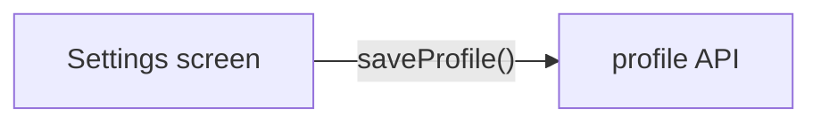

# Review guide

The PR description is the review guide. It lets a reviewer read a PR in order of risk without asking the author anything. Build it only from what the run already produced: the decision trail, commits, proof files, logs, and the commands you ran. Do not start review sessions, capture new proof, or rerun work to fill it.

There is no Orca artifact, no HTML file, no link-out, and no `## Review guide` section with a URL. Diagrams, screenshots, and video render in the description itself. Nothing goes into git: no `REVIEW.md`, no proof media on any branch, and no media branch.

Skip this skill for docs-only PRs. Skip trivial PRs too, such as a typo or a version bump with no code change, unless they carry visual proof. Those PRs still use the section headings from [Opening a PR](../amillez-mode/playbooks/opening-a-pr.md) and drop the sections that have nothing to say.

## 1. Write the body file

Write the body to `~/agent-work/proof/<slug>/pr-body.md`, next to the run's local proof. The akit install lets Claude Code read that directory without a prompt. Keep the same path for the life of the PR.

Use these `##` sections in this order. Drop section 8 when it does not apply.

1. **Summary and risk.** What the PR does in two or three sentences, and a risk level (low, medium, or high) with the reason.
2. **What changed and why.** From the [`show-me-your-work`](../show-me-your-work/SKILL.md) trail when the run kept one, else from the commits and the plan. One line per decision with its reason.
3. **Blast radius.** Who or what the change touches beyond the diff, and the one fact it is safe because of. Take it from the [`blast-radius`](../blast-radius/SKILL.md) output when that skill ran. Mark the fact unproven when nothing proved it.
4. **Proof.** Each screenshot, video, or log excerpt with a pass or fail note against the success criteria. Say what matched and what didn't.
5. **How to reproduce.** The `verify-<app>` commands, or the exact commands you ran, in code blocks.
6. **Review order.** Critical files first. Each entry links to the exact lines at the PR head SHA, as `https://github.com/<owner>/<repo>/blob/<head-sha>/<path>#L<start>-L<end>`. Get the SHA with `gh pr view <number> --json headRefOid -q .headRefOid`.
7. **Critical parts and why.** The few hunks a reviewer must not skim, and what breaks if they are wrong.
8. **Diagrams.** Only when the change spans several modules or changes a flow.

Before the PR exists, write section 6 against your pushed branch head (`git rev-parse HEAD`), which becomes the PR head.

## 2. Draw diagrams in Mermaid

Draw each diagram as a fenced `mermaid` block in the body. Make `%%{init: {'theme': 'default'}}%%` the first line of each block. Without it, GitHub draws the dark theme for a reader in dark mode. With it, the diagram stays light. This was verified on github.com in dark mode on 2026-11-12, in [amillez/ai-eng-practices#95](https://github.com/amillez/ai-eng-practices/pull/95).

````markdown

````

- Label each arrow with the call or method it stands for.
- Put a caption of 2 to 4 sentences under the diagram that states the key invariants.
- For a state machine, prefer the [`statechart`](../statechart/SKILL.md) skill's Mermaid output.

A hand-built HTML or SVG diagram is a fallback for when Mermaid is too limited. Export it as SVG or PNG and attach it like a screenshot in [step 3](#3-attach-media-inline). GitHub strips inline SVG and HTML from the body.

## 3. Attach media inline

Keep each screenshot and video under `~/agent-work/proof/<slug>/`. Reference each one from the body file by a path relative to that file:

```markdown

```

Every screenshot and video must render in the description. Never put proof only behind a link.

`gh pr create` and `gh pr edit` take a repeatable `--attach <file>`. `gh` uploads each file to `https://github.com/user-attachments/assets/<uuid>` and rewrites the matching `` reference in the body in place. It appends a file the body does not reference. Facts checked on 2026-11-12 against gh 2.103.3 and GitHub's [attaching files with GitHub CLI](https://docs.github.com/en/github-cli/github-cli/attaching-files-with-github-cli) docs:

- It needs gh 2.99.0 or later and write access to the repo.
- It takes PNG, JPEG, GIF, WebP, SVG, MP4, MOV, and WebM. Images can be up to 10 MB each. One command takes up to 50 files.
- Uploads in a public repo open without sign-in. Uploads in a private or internal repo open only for people with access to the repo, so they do not render in email notifications or for anyone else.
- GitHub Enterprise Server does not support it.
- The Actions `GITHUB_TOKEN` cannot upload. Attach from a host's `gh` login, never from CI.

Downscale large screenshots first so they stay readable and under the limit:

```bash
sips -Z 1600 shot.png --out shot-1600.png
```

## 4. Scrub before you attach

Open every image and check it before you attach it.

- Leave secrets, tokens, keys, cookies, and env values out of screenshots, logs, and code snippets.
- Leave personal user data out, such as real names, emails, phone numbers, and account IDs.

## 5. Open the PR with the body

Run the commands from the proof directory, so `gh` resolves `./x.png` next to the body file:

```bash
cd ~/agent-work/proof/<slug>
gh pr create --title "<type(scope): subject>" --body-file pr-body.md \
  --attach ./settings-before.png --attach ./settings-after.png
```

Run it as its own command. Never chain it with `gh pr checks --watch` or any other command, since a long or failing command in the chain hides whether the body landed.

## 6. Verify the body

Fetch the stored body with `jq -j`, since `-q .body` adds a trailing newline that each later edit would store:

```bash
gh pr view <number> --json body | jq -j .body > pr-body.md
grep -o 'https://github.com/user-attachments/assets/[^)]*' pr-body.md | wc -l
grep -nE '\]\((\./|/Users/|~/)' pr-body.md
```

The first `grep` prints the number of uploaded files you expect. The second prints nothing, because no local path is left. If either check fails, fix the body file and run [step 7](#7-update-on-each-push).

Check that one upload serves an image. Use a GET, not `curl -I`. GitHub redirects to a signed S3 URL that answers a HEAD with 403:

```bash
curl -sL -o /dev/null -w '%{http_code} %{content_type}\n' '<user-attachments url>'
```

A public repo prints `200 image/png` or the matching type. A private repo needs a signed-in browser for this check.

Keep the fetched `pr-body.md`. It now holds the user-attachments URLs, and it is the base for every later edit.

## 7. Update on each push

After each push, update section 6 to the new head SHA and refresh the sections the push changed. Edit the body file that you fetched in [step 6](#6-verify-the-body), so it keeps the user-attachments URLs from earlier uploads. Pass `--attach` only for new or changed media:

```bash
cd ~/agent-work/proof/<slug>
gh pr view <number> --json body | jq -j .body > pr-body.md
# edit pr-body.md
gh pr edit <number> --body-file pr-body.md --attach ./new-shot.png
```

`gh pr edit --body-file` replaces the whole body, so never start an edit from a body file older than the PR's current body. Run [step 6](#6-verify-the-body) again after each edit.

If `gh pr edit` exits non-zero, for example with `GraphQL: Projects (classic) is being deprecated`, it has not changed the body. When the edit attaches no new media, write the same file through the REST API instead, then verify again:

```bash
gh api -X PATCH repos/<owner>/<repo>/pulls/<number> -F body=@pr-body.md
```

The REST call cannot attach. With new media, fix the `gh pr edit` failure first.
